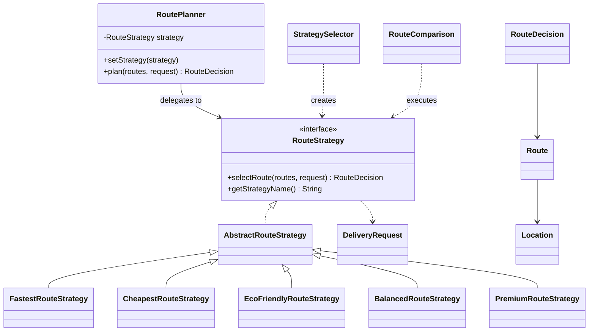
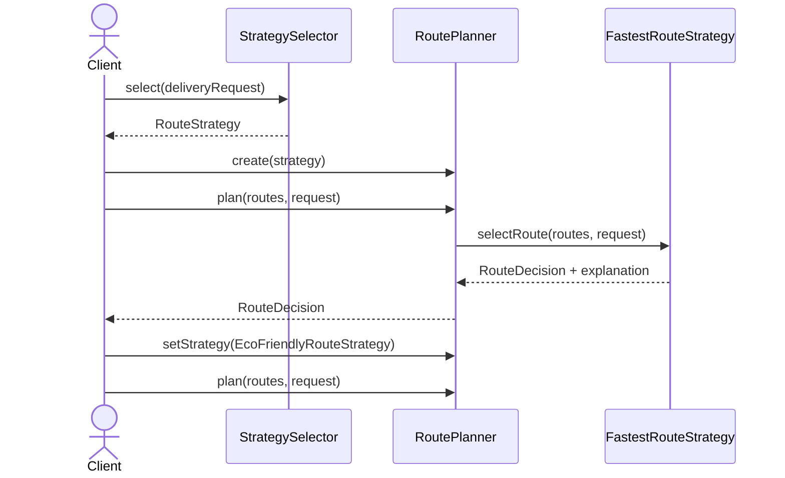

# Smart Delivery & Route Optimization Engine

**Assignment 5 — Strategy Pattern | Java 17 | Maven | JUnit 5**

## Problem and solution
A delivery system can optimize routes for time, cost, emissions, or a weighted balance of criteria. The Strategy Pattern puts each algorithm in a separate class so algorithms can be changed without rewriting the planner.

## Architecture
- **Context:** `RoutePlanner` delegates to its current `RouteStrategy`.
- **Strategy abstraction:** `RouteStrategy`.
- **Concrete strategies:** `FastestRouteStrategy`, `CheapestRouteStrategy`, `EcoFriendlyRouteStrategy`, `BalancedRouteStrategy`, and the added `PremiumRouteStrategy`.
- **Automatic selection:** `StrategySelector` maps delivery priority to a strategy using a configurable registry.
- **Comparison:** `RouteComparison` executes multiple strategies for the same request.
- **Domain model:** `Location`, `Route`, `DeliveryRequest`, `RouteDecision`, and `DeliveryPriority`.
- **Failure handling:** `NoSuitableRouteException` explains when no valid route exists.

## Business formulas
1. **Total cost** = base cost + distance (km) × 20 + urgent surcharge (800 when priority is `URGENT`).
2. **Eco score** = carbon emissions (kg) × 0.8 + distance (km) × 0.2. Lowest wins.
3. **Balanced score** = normalized time × time weight + normalized cost × cost weight + normalized distance × distance weight + normalized emissions × emission weight. The default weights are 0.40, 0.30, 0.10, 0.20. All weights must be finite, non-negative, and sum to 1.0.
4. **Effective time** = estimated minutes + traffic penalty.

All strategies filter unavailable/prohibited routes and routes that exceed the request's budget, deadline, or emissions limit before ranking candidates.

## Run
Requires JDK 17+ and Maven 3.9+.

```bash
mvn test
mvn package
java -cp target/classes edu.aitu.delivery.Main
```

## Runtime switching
`Main` uses the same `RoutePlanner` object and switches from fastest to cheapest, eco-friendly, and balanced strategies at runtime.

## Why Strategy instead of if/else?
Each algorithm is encapsulated behind one interface. `RoutePlanner` does not inspect concrete strategy types or switch on names. A new strategy can be added as a new class and registered with `StrategySelector`; the planner itself does not need changes.

## Strategy vs Bridge
Strategy replaces one interchangeable algorithm at runtime to change *how* a task is performed. Bridge separates two independently varying dimensions of an abstraction and its implementation. In this project, route selection algorithms are interchangeable behaviors, so Strategy is the direct fit.

## SOLID
- **SRP:** planner, strategy selection, algorithms, domain model, and comparison have separate responsibilities.
- **OCP:** new route algorithms can be introduced as new `RouteStrategy` implementations.
- **DIP:** `RoutePlanner` depends on `RouteStrategy`, not concrete algorithms.

## Limitations
This is a teaching/demo application. Candidate routes and traffic/emission data are static; the cost and eco formulas are illustrative, not live logistics pricing or certified emissions calculations. Balanced normalization uses the maximum among currently valid candidates, so scores can change when the candidate set changes.

## UML Class Diagram


## UML Sequence Diagram


## Example output
Run `Main` to print the chosen route, time, estimated cost, emissions, explanation, runtime switching, automatic selection, and comparison mode. Exact chosen routes depend on the constraints and configured weights.

## Tests
The JUnit 5 suite contains 23 meaningful tests covering all four original strategies, fifth strategy, runtime switching, automatic selection, constraints, no-valid-route, invalid weights, comparison, boundary and failure cases. Run `mvn test` to see the actual result on your machine.
